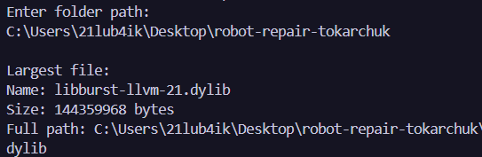
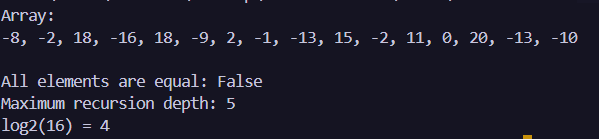
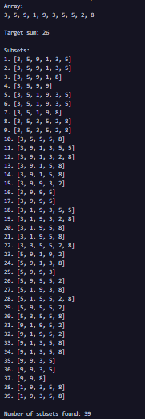
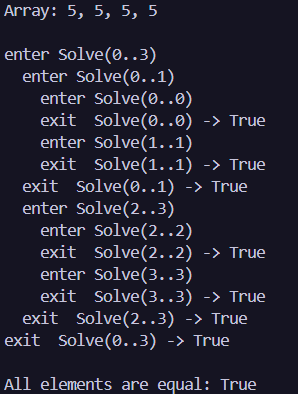

N = 26, K = 16, a = 2, b = 2, c = 1

# Лабораторна робота №3 — Рекурсивні алгоритми

**Дисципліна:** Основи програмування та алгоритмічні мови  
## Завдання 1. Обхід каталогів

Рекурсивно знайдено найбільший файл у каталозі та вкладених папках.

**Результат:**
### 
**Базовий випадок:** якщо каталог не має підкаталогів, рекурсивний цикл завершується, а функція повертає найбільший знайдений файл або `null`.

## Завдання 2. Розбиття навпіл

**Результат:**
### 
**Базовий випадок:** якщо `lo == hi`, функція повертає `true`.
Максимальна глибина — 5 рівнів. \(\log_2(16)=4\) поділи, тобто 5 рівнів, якщо враховувати перший виклик.

## Завдання 3. Перебір підмножин
Знайдено всі підмножини 10 випадкових чисел у діапазоні від 1 до 9 із сумою:
\(S = 16 \bmod 20 + 10 = 26\).
**Результат:** 
### 
**Базові випадки:** пошук завершується, коли сума дорівнює 26, індекс виходить за межі масиву або поточна сума перевищує 26.

## Завдання 4. Трасування рекурсії

**Результат:**
### 

**Пояснення:** `enter` показує початок виклику функції. `exit` з'являється у зворотному порядку, оскільки спочатку завершуються вкладені виклики.

## Завдання 5. Ітеративна версія
Обидві версії перевіряють той самий масив і мають повертати однаковий результат.

**1. Який варіант зрозуміліший?**
Для цієї задачі цикл зрозуміліший, оскільки послідовно порівнює кожен елемент із першим. Рекурсивний варіант додатково поділяє масив на частини.

**2. Чому обхід каталогів складніше переписати циклом?**
Потрібно вручну зберігати шляхи до каталогів, які ще не перевірені. Для цього можна використати `Stack<string>`, тоді як рекурсія автоматично зберігає незавершені виклики у стеку викликів.

## Перевірка крайових випадків

| Вхід | Завдання | Очікувано | Отримано |
|---|---:|---|---|
| Порожня папка | 1 | `No files found.` | Не перевірено |
| Немає доступу до папки | 1 | Повідомлення про відмову в доступі | Не перевірено |
| Масив `[7]` | 2 | `true` | Не перевірено |
| Масив `[5, 5, 5, 5]` | 2 | `true` | `true` |
| Масив із десяти одиниць | 3 | 0 підмножин із сумою 26 | Не перевірено |

## Висновок

У роботі реалізовано рекурсивний обхід каталогів, поділ масиву навпіл і перебір підмножин із поверненням. Досліджено стек викликів і порівняно рекурсивний алгоритм із циклічним.