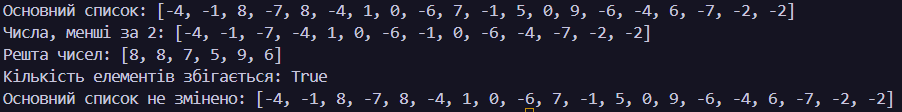
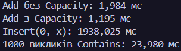

### N = 7, K = 19, a = 1, b = 3, c = 2
### Лабораторна робота № 4
### Алгоритми над списками
### Дисципліна: Основи програмування та алгоритмічні мови

### Завдання 1
Створено список із 20 випадкових цілих чисел у діапазоні від -9 до 9. За допомогою циклу foreach сформовано новий список, що містить лише додатні непарні числа. Початковий список не змінювався. Виведено результат і кількість елементів.
### 

### Завдання 2
Реалізовано три способи видалення чисел, кратних трьом: неправильний прохід циклом уперед, правильне видалення з кінця списку та створення нового списку. Визначено елементи, пропущені неправильним алгоритмом, і перевірено збіг результатів двох правильних способів.
### 

### Завдання 3
Створено два відсортовані списки розмірами 11 і 6 елементів. За допомогою двох індексів їх об'єднано в один відсортований список. Після об'єднання перевірено правильність упорядкування елементів.
### 

### Завдання 4
Початковий список розділено на два нові списки: числа, менші за 2, та числа, більші або рівні 2. Початковий список залишився незмінним. Перевірено, що сума кількостей елементів двох нових списків дорівнює кількості елементів початкового списку.

### 

### Завдання 5
За допомогою Stopwatch виміряно час виконання операцій Add без заданої місткості та з нею, Insert(0, x) і Contains. Результати дають змогу порівняти продуктивність операцій зі списками та пояснити вплив виділення пам'яті, переміщення елементів і послідовного пошуку.
| Операція | Кількість | Час, мс |
|---|---:|---:|
| `Add` без `Capacity` | 100 000 | 1,984 |
| `Add` із `Capacity` | 100 000 | 1,195 |
| `Insert(0, x)` | 100 000 | 1938,025 |
| `Contains` для відсутнього елемента | 1 000 викликів | 23,980 |

### 