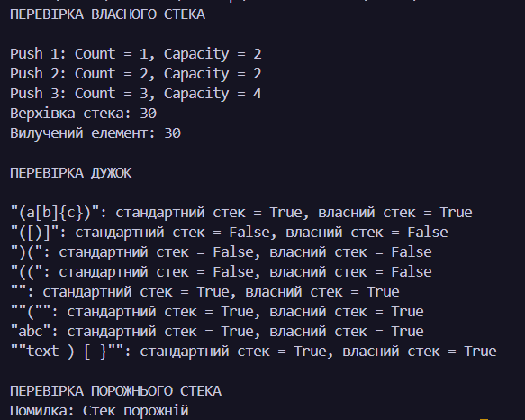
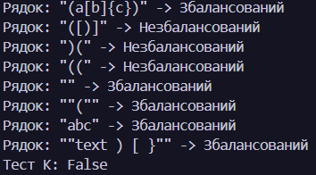
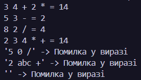
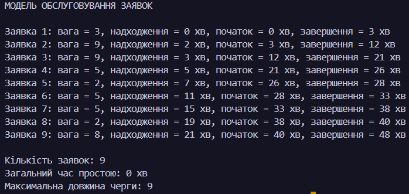

N = 26, K = 16, a = 2, b = 2, c = 1.
### 

### Обґрунтування вибору структур даних

### Завдання 1. Перевірка збалансованості дужок
Використовується стек, тому що остання відкрита дужка має закриватися першою. Якщо використати чергу, дужки перевірялися б у порядку надходження, через що вкладені дужки могли б перевірятися неправильно. Наприклад, рядок ([)] не є збалансованим.
### 

### Завдання 2. Зворотний польський запис
Використовується стек, тому що для кожної операції потрібно взяти два останні числа, виконати дію та повернути результат назад у стек. Черга не підходить, оскільки вона повертає перший доданий елемент, а для обчислення потрібно брати останні числа. Через це порушився б порядок операндів, наприклад у виразі 5 3 - результат має бути 2, а не -2.
### 

### Завдання 3. Модель обслуговування заявок
Використовується черга, тому що заявки обслуговуються в порядку надходження: першою обробляється заявка, яка прийшла раніше. Якщо використати стек, остання заявка обслуговувалася б першою, що порушило б правильний порядок обслуговування.
### 

### Завдання 4. Власна реалізація стека
Під час тестування власного стека початкова місткість масиву становила 2. Після першого та другого додавання місткість не змінювалася, а після третього збільшилася до 4. Метод Peek() повернув верхній елемент 30, а Pop() видалив його. Під час перевірки дужок результати власного стека збіглися з результатами стандартного Stack<char> для всіх тестових рядків. Також перевірено виклик Pop() на порожньому стеку — програма вивела повідомлення, що стек порожній».
### 

### Чому Queue.Dequeue() дешевший за List.RemoveAt(0)
Під час видалення першого елемента зі списку List.RemoveAt(0) решту елементів потрібно зсунути на одну позицію вліво. Через це зі збільшенням списку операція потребує більше часу. Черга Queue<T> організована так, щоб забирати елемент із початку без такого зсування всіх наступних елементів, тому Dequeue() зазвичай виконується за сталий час.

### Висновок
Під час виконання лабораторної роботи я навчився використовувати стеки та черги для розв’язання різних задач. Реалізував перевірку збалансованості дужок, обчислення виразів у зворотному польському записі та моделювання обслуговування заявок. Також створив власну реалізацію стека на основі масиву та перевірив його роботу. Я зрозумів, що правильний вибір структури даних допомагає ефективніше розв’язувати задачі.