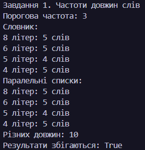
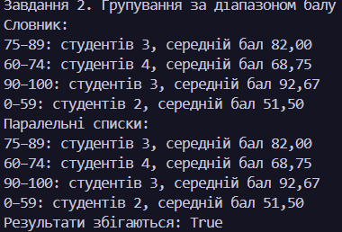
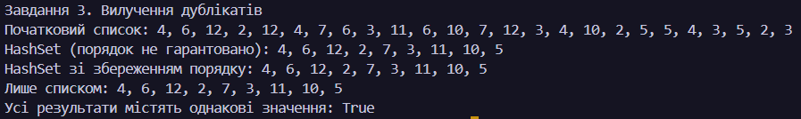
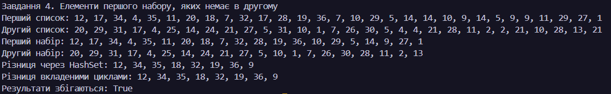
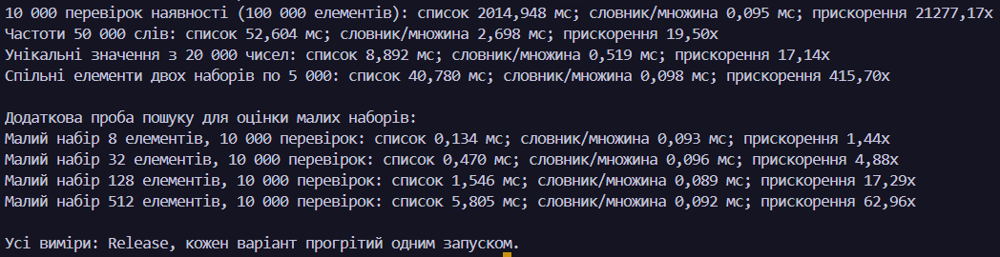

# N = 26, K = 16, a = 2, b = 2, c = 1

# Лабораторна робота 6 — алгоритми підрахунку та групування
# Лабораторна робота: Порівняння продуктивності колекцій у C#
# Виконав: Токарчук Любомир

## Завдання 1. Порівняння пошуку елементів
Реалізовано пошук елементів у масиві та `HashSet<int>`. Для обох способів використано однакові дані й запити. Час виконання вимірюється за допомогою `Stopwatch`, після чого результати порівнюються для визначення ефективнішого способу пошуку.
### 

## Завдання 2. Підрахунок частоти слів
Реалізовано підрахунок частоти слів двома способами: за допомогою списків і за допомогою `Dictionary<string, int>`. Програма перевіряє правильність підрахунку та вимірює час виконання кожної реалізації, щоб порівняти їхню продуктивність.
### 

## Завдання 3. Видалення дублікатів
Порівняно видалення повторюваних чисел за допомогою `List<int>` і `HashSet<int>`. Обидва способи обробляють однаковий набір даних, а результати перевіряються на відповідність. Це дає змогу оцінити вплив структури даних на швидкість пошуку унікальних елементів.
### 

## Завдання 4. Пошук спільних елементів
Реалізовано пошук спільних елементів двох наборів чисел за допомогою списків і множин `HashSet<int>`. Для обох алгоритмів вимірюється час виконання та перевіряється правильність отриманих результатів.
### 

## Завдання 5. Дослідження малих наборів даних
Проведено порівняння швидкості пошуку у `List<int>` і `HashSet<int>` для наборів різного розміру. Досліджуються набори з 8, 32, 128 і 512 елементів, щоб визначити, як розмір колекції впливає на час виконання пошуку.
### 

## Порівнювані операції

| Операція | Перша реалізація | Друга реалізація |
|---|---|---|
| Пошук | Масив | `HashSet<int>` |
| Частота слів | Списки | `Dictionary<string, int>` |
| Видалення дублікатів | `List<int>` | `HashSet<int>` |
| Спільні елементи | Списки | `HashSet<int>` |
| Пошук у малих наборах | `List<int>` | `HashSet<int>` |

## Висновок

У лабораторній роботі досліджено продуктивність різних структур даних у C#. За допомогою `Stopwatch` вимірюється час виконання операцій, а перевірка результатів допомагає переконатися в правильності реалізацій. Отримані вимірювання дають змогу порівняти ефективність масивів, списків, словників і множин та зрозуміти, як вибір структури даних впливає на продуктивність програми.