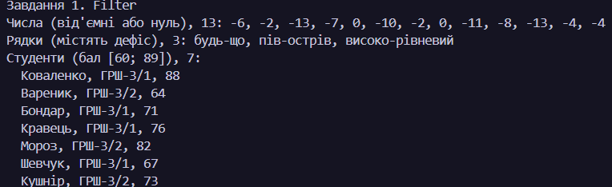
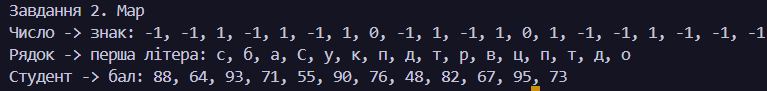
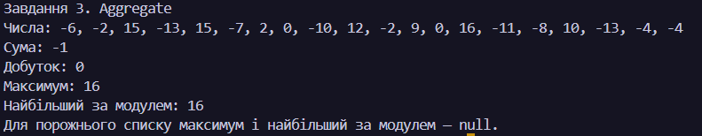
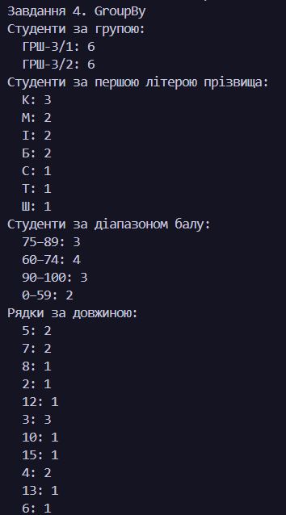
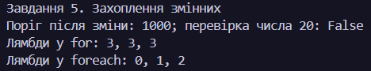

N = 26, K = 16, a = 2, b = 2, c = 1

# Лабораторна робота 7 — узагальнені алгоритми, налаштовані делегатом

# Основи програмування та алгоритмічні мови, КН-3/1

# Виконав: Токарчук Любомир

## Завдання 1. Відбір елементів

Реалізовано один узагальнений алгоритм `Filter<T>`. Його застосовано без зміни тіла алгоритму до трьох наборів: чисел із критерієм «від'ємне або нуль», рядків із дефісом і студентів із балом у межах `[60; 89]`. Тіло `Filter` між трьома застосуваннями змінювалося **0 разів**.

### 

## Завдання 2. Перетворення елементів

Узагальнений `Map<TIn, TOut>` застосовано до чисел, рядків і студентів. Числа перетворюються на знак `-1`, `0` або `1`, рядки — на першу літеру, а студенти — на значення бала. Тип результату не обмежений типом елемента джерела.

### 

## Завдання 3. Агрегація

За допомогою одного `Aggregate<T, TAcc>` обчислено суму, добуток, максимум і найбільший за абсолютною величиною елемент набору чисел. Для добутку використано `BigInteger`, щоб зберегти точність; для максимуму та найбільшого за модулем — nullable-стан, який коректно представляє порожній список.

**Сума**

- Стан: `int`
- Старт: `0`
- Крок: `state + number`

**Добуток**

- Стан: `BigInteger`
- Старт: `BigInteger.One`
- Крок: `state * number`

**Максимум**

- Стан: `int?`
- Старт: `null`
- Крок: якщо стан `null` або поточне число більше за стан, зберегти число; інакше залишити стан.

**Найбільший за абсолютною величиною**

- Стан: `int?`
- Старт: `null`
- Крок: якщо стан `null` або модуль поточного числа більший за модуль стану, зберегти число; інакше залишити стан.

Для порожнього списку сума дорівнює `0`, добуток - `1`, а максимум і найбільший за модулем повертають `null`. Це не повертає вигадане значення, якого немає у вхідних даних.

### 

## Завдання 4. Групування елементів

Реалізовано один узагальнений `GroupBy<T, TKey>` із функцією обчислення ключа. Його застосовано до студентів для групування за навчальною групою, першою літерою прізвища та діапазоном бала (0–59, 60–74, 75–89, 90–100), а також до рядків для групування за довжиною. Для кожної групи виводиться ключ і кількість елементів.

### 

## Завдання 5. Захоплення змінних

Відтворено три ситуації із замиканнями. Делегат із порогом після зміни змінної перевіряє нове значення `1000`, лямбди з циклу `for` повертають однакове кінцеве значення лічильника `3`, а лямбди з `foreach` — окремі значення елементів `0`, `1`, `2`.
Щоб лямбди з `for` повертали різні значення, потрібно в кожній ітерації скопіювати лічильник у локальну змінну й захоплювати цю копію.

### 

## Завдання 6. Висновок

### Що дало узагальнення

У Лабораторній 4 критерій був зашитий у функцію. Для трьох критеріїв і трьох типів даних довелося б написати дев'ять окремих функцій. У цій роботі достатньо одного `Filter<T>` і дев'яти застосувань із переданими предикатами; код самого алгоритму не змінюється.

### Де узагальнення було б зайвим

Приклад — порівняння пошуку `int` у `List<int>` і `HashSet<int>` для фіксованих розмірів наборів у Лабораторній 6, завданні 5. Мета цього коду — порівняти саме ці дві структури даних, а не створити бібліотеку пошуку для багатьох типів і сценаріїв. Узагальнений API в такому невеликому експерименті лише ускладнив би код без практичної користі.

## Дані та запуск

Варіант: `N = 26`, `K = 16`, `a = 2`, `b = 2`, `c = 1`. Для завдань із числами створюються 20 значень у діапазоні `[-16; 16]` за допомогою `new Random(26)`. Набір рядків містить 16 слів різної довжини, з дефісами та без; набір студентів містить 12 записів із полями `Name`, `Group`, `Score`, узятих із Лабораторної 6.
Алгоритми розташовані в окремому проєкті `algorithms`. Застосування розділені на проєкти `task-1`–`task-5`; кожен із них можна запустити окремо:

```powershell
dotnet run --project LAB-7/task-1/task-1.csproj
dotnet run --project LAB-7/task-2/task-2.csproj
dotnet run --project LAB-7/task-3/task-3.csproj
dotnet run --project LAB-7/task-4/task-4.csproj
dotnet run --project LAB-7/task-5/task-5.csproj
```

## Перевірка крайових випадків

| Вхід                                  | Завдання                         | Очікуваний результат            | Фактичний результат                     |
| ------------------------------------- | -------------------------------- | ------------------------------- | --------------------------------------- |
| Порожній список                       | `Filter`, `Map`                  | Порожній список                 | Порожній список                         |
| Жоден елемент не проходить критерій   | `Filter`                         | Порожній список                 | Порожній список                         |
| Порожній список                       | Сума, добуток через `Aggregate`  | `0`, `1`                        | `0`, `1`                                |
| Порожній список                       | Максимум і найбільший за модулем | `null`, оскільки елемента немає | `null`, `null`                          |
| Один елемент `7`                      | Максимум через `Aggregate`       | `7`                             | `7`                                     |
| Порожній список                       | `GroupBy`                        | Порожній словник                | Порожній словник                        |
| Усі студенти належать до однієї групи | `GroupBy`                        | Одна група з усіма студентами   | Одна група з двома тестовими студентами |

Крайові випадки перевіряються в самих програмах. У разі невідповідності очікуванню програма завершується з `InvalidOperationException`.

## Висновок

У роботі критерії відбору, правила перетворення, кроки агрегації та функції ключа передаються узагальненим алгоритмам через делегати. Завдяки цьому ті самі реалізації працюють із числами, рядками та студентами. Приклади із замиканнями показують, що делегати захоплюють змінні, а не обов'язково їхні значення на момент створення; розуміння цього важливе для правильного результату.
