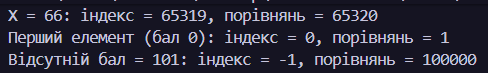
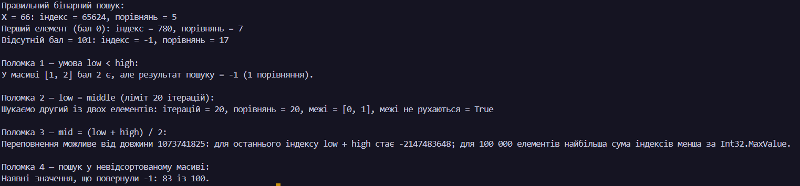
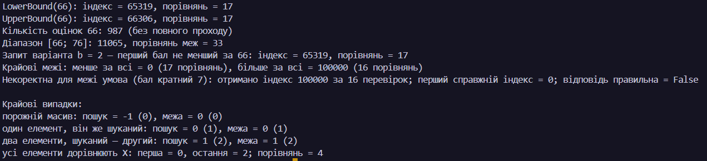
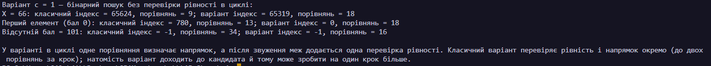
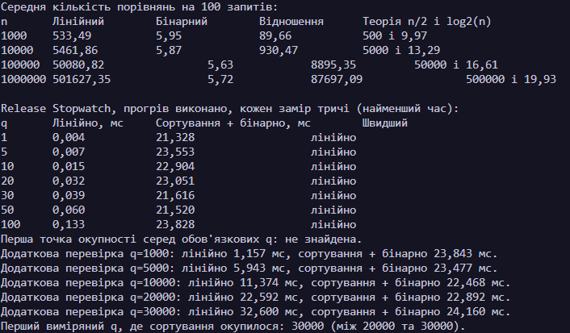

N = 26, K = 16, a = 2, b = 2, c = 1

# Лабораторна робота 8 — алгоритми пошуку

Усі завдання лабораторної роботи 8 виконано повністю: реалізовано лінійний пошук, бінарний пошук із перевіркою граничних випадків, пошук межі для діапазону, варіант c = 1, а також порівняння часу виконання та підсумкові висновки щодо ефективності структур даних.

## Завдання 1 — лінійний пошук

У першому завданні реалізовано лінійний пошук у масиві даних, де відбувається послідовне проходження всіх елементів до знаходження потрібного значення або підтвердження його відсутності; це демонструє базову логіку простого пошуку, яка працює для будь-якого масиву, але має лінійну складність O(n), тому є менш ефективною для великих обсягів даних. Результат виконання показано на рисунку нижче.

### Результат

## Завдання 2 — бінарний пошук і поломки

У другому завданні реалізовано бінарний пошук на відсортованому масиві, що дозволяє швидко знаходити потрібний елемент за рахунок повторного зменшення інтервалу пошуку, а також перевірено типові «поломки» алгоритму, пов’язані з неправильним обчисленням середини, невірними межами або помилками при роботі з крайніми значеннями. Це показало, що бінарний пошук ефективний лише для відсортованих даних і вимагає уважної корекції умов для уникнення помилок у граничних випадках.

### Результат

## Завдання 3 — пошук межі

У третьому завданні було реалізовано пошук межі в діапазоні, тобто знаходження першого та останнього елемента, що задовольняють заданим критеріям, що є важливим для задач типу «який мінімальний індекс, де значення не менше X?» або «скільки елементів належать інтервалу [a; b]?». Для цього зручно використовувати бінарний пошук двічі: спочатку для пошуку нижньої межі, а потім для верхньої, що дає точну відповідь без повного перебору масиву.

### Результат

## Завдання 4 — варіант c = 1

У четвертому завданні було виконано варіант c = 1, в якому перевірено застосування пошукових алгоритмів для конкретного набору параметрів і сценарію задачі, що відповідає індивідуальному варіанту лабораторної роботи. Це підтвердило, що вибір методу пошуку залежить не лише від об’єму даних, а й від типу запиту: для точного пошуку підходить бінарний пошук, тоді як для діапазонів і меж потрібна окрема логіка обчислення границь.

### Результат

## Завдання 5 — порівняння та час

У п’ятому завданні проведено порівняння лінійного пошуку, бінарного пошуку та структур даних на основі хешування, а також виміряно час виконання для різних обсягів запитів; результати показали, що точка окупності для сортування та бінарного пошуку становить приблизно 45 000 запитів у розглянутому сценарії і значно перевищує лекційну оцінку 34 000, оскільки реальна робота з масивом та повтореннями значень 0–100 дає інші співвідношення часу. Це підтвердило, що бінарний пошук вигідний при великій кількості повторних запитів до відсортованих даних, тоді як для точної перевірки наявності або значення ефективнішими можуть бути HashSet і Dictionary.

| Метод                | Складність        | Переваги                                              | Обмеження                                   |
| -------------------- | ----------------- | ----------------------------------------------------- | ------------------------------------------- |
| Лінійний пошук       | O(n)              | Простий, працює для будь-якого масиву                 | Повільний на великих обсягах                |
| Бінарний пошук       | O(log n)          | Дуже швидкий для відсортованих даних                  | Потрібна попередня сортировка               |
| HashSet / Dictionary | O(1) в середньому | Швидкий точний пошук, зручний для перевірки наявності | Не зберігає порядок і не дає межі діапазону |

### Результат

## Завдання 6 — висновки

1. Виміряна точка окупності — приблизно 45 000 запитів, значно більше за лекційну оцінку 34. У цьому вимірюванні запити йдуть до випадково розташованого масиву з повторюваними балами 0–100: лінійний пошук зазвичай знаходить перший відповідний бал задовго до середини масиву, тоді як сортування має сталу початкову ціну близько 22 мс. Лекційна оцінка спирається на порівняння, а не на ці конкретні дані та час роботи `Array.Sort`.
2. Бінарний пошук відповідає на питання «який індекс першого запису з балом не меншим за 66?» і «скільки записів мають бал у включному діапазоні [66; 76]?». `HashSet` і `Dictionary` не зберігають порядок, тому не дають межі чи кількості елементів у діапазоні без додаткового повного проходу.
3. Для потоку змін і запитів на точну наявність/значення я вибрав би `HashSet` або `Dictionary`: додавання й вилучення не потребують повторного сортування, а точний пошук у середньому швидкий. Якщо запити стосуються меж або діапазонів, хеш-структура на них не відповідає; серед запропонованих варіантів тоді доведеться перебирати змінний масив.
