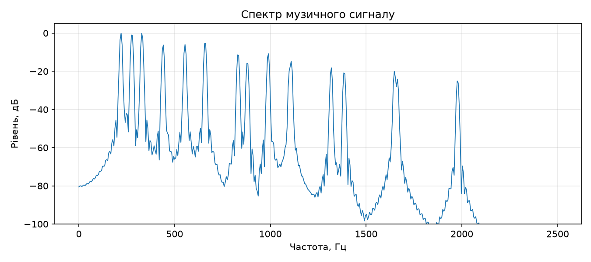
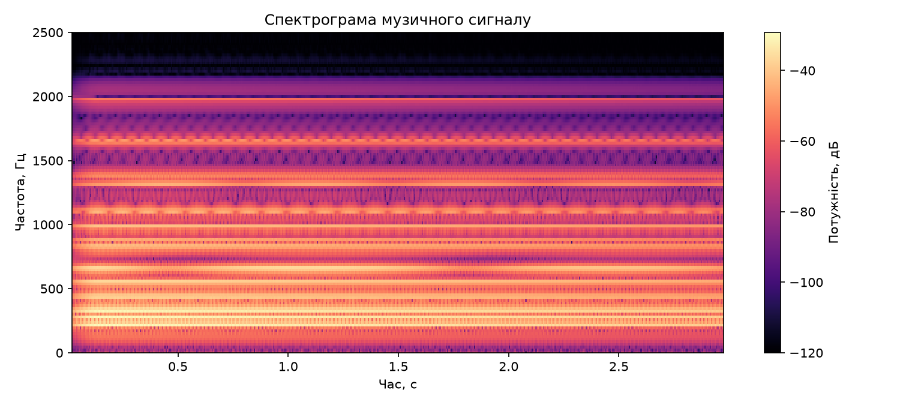
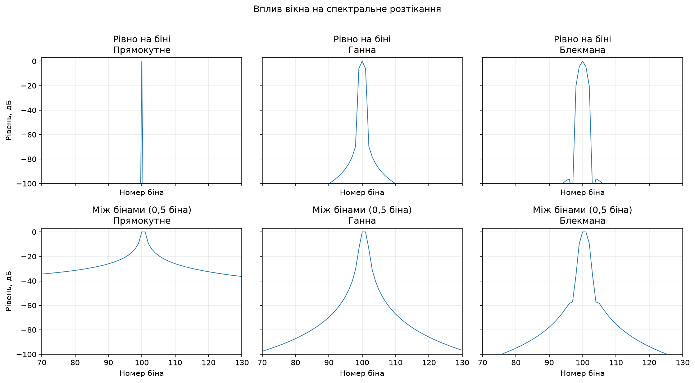
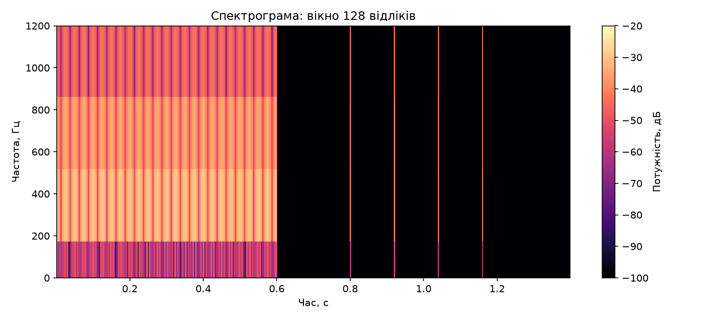
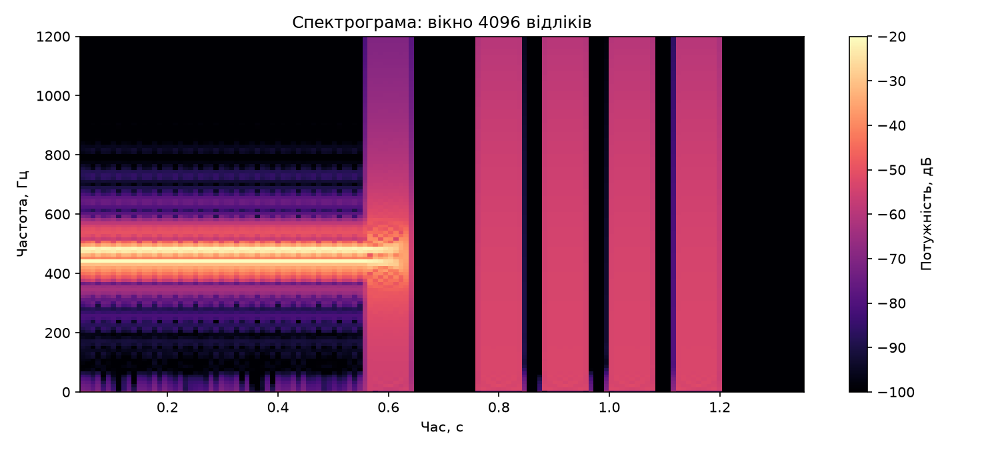
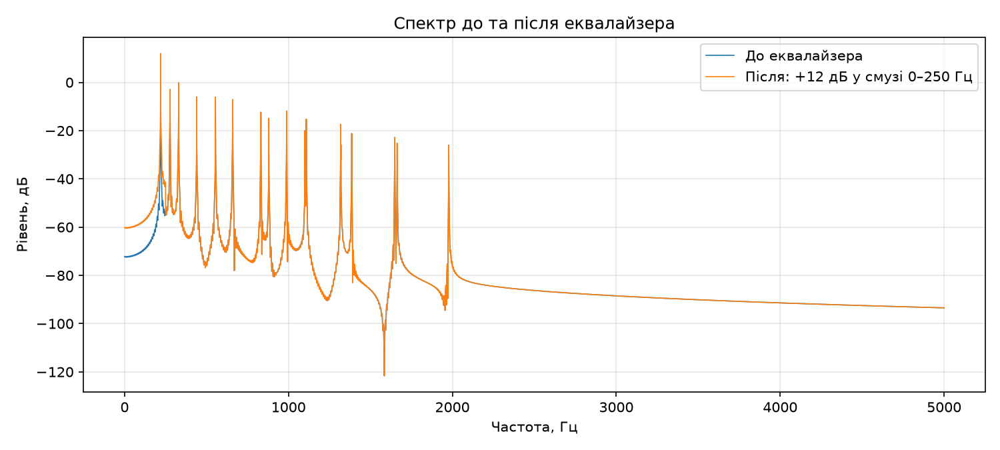
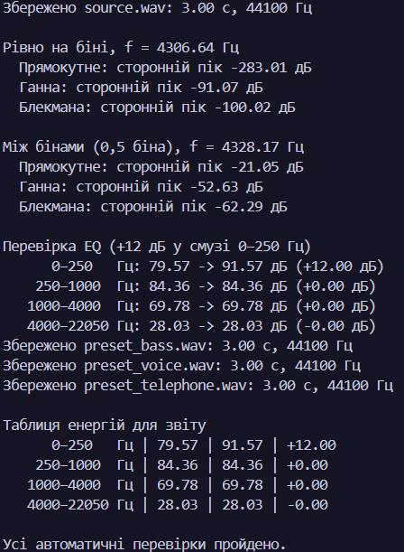

# Лабораторна робота 13 — спектральний аналіз

У роботі досліджено спектр і спектрограму звуку, спектральне розтікання для різних вікон, компроміс між часовою та частотною роздільністю, а також реалізовано й чисельно перевірено еквалайзер.

## Завдання 1 — спектр і спектрограма

Використано синтезований акорд із основними частотами 220, 277,18 і 329,63 Гц та гармоніками. Для спектра взято фрагмент 8192 відліки з вікном Ганна; спектрограма побудована з вікном 2048 і перекриттям 1792 відліки.

### Результати

н
У спектрі помітні піки основних тонів та їхніх гармонік. У спектрограмі видно, як компоненти акорду змінюються в часі відповідно до атаки й затухання сигналу.

## Завдання 2 — порівняння вікон

Виміряно найбільший сторонній пік відносно максимального піка спектра. Для тону рівно на біні прямокутне вікно дає чисельно практично нульове розтікання (нижче −250 дБ у вимірюванні). Для тону між бінами результат запуску скрипта наведено нижче:

| Положення тону        | Прямокутне, дБ | Ганна, дБ | Блекмана, дБ |
| --------------------- | -------------: | --------: | -----------: |
| Рівно на біні         |        −283,01 |    −91,07 |      −100,02 |
| Між бінами (0,5 біна) |         −21,05 |    −52,63 |       −62,29 |

Значення для точного потрапляння на бін залежать від округлення чисел із рухомою комою; у цьому запуску прямокутне вікно дає −283,01 дБ. Вікно Ганна зменшило сторонній пік на 31,58 дБ відносно прямокутного, тобто приблизно у 38 разів за амплітудою. За це платимо ширшою головною пелюсткою: вона становить близько 4 бінів для Ганна проти 2 для прямокутного вікна. Блекман має ще нижчі бічні пелюстки, але ще ширшу головну пелюстку.

## Завдання 3 — час і частота

Сигнал містить два близькі тони 440 і 480 Гц, а після них — чотири короткі клацання. Для порівняння використано вікна 128 і 4096 відліків.

На короткому вікні клацання локалізовані в часі, але тони 440 і 480 Гц не розрізняються чітко. Довге вікно розділяє ці тони за частотою, проте розтягує клацання в часі. Для мови доцільніше коротке вікно близько 20–30 мс (наприклад, 1024 відліки при 44,1 кГц), оскільки важлива локалізація швидких змін. Для настроювання гітари краще довге вікно (4096 або більше відліків), адже воно дає точнішу оцінку частоти стабільного тону.

## Завдання 4 — еквалайзер

Еквалайзер множить спектральні компоненти в заданих смугах на коефіцієнт `10 ** (dB / 20)`, а потім відновлює сигнал через `irfft`. Межі смуг задаються напіввідкритим інтервалом `[low, high)`, щоб сусідні смуги не накладалися.

Для перевірки басову смугу 0–250 Гц підсилено на 12 дБ. Відхилення енергії підсиленої смуги від +12 дБ і решти смуг від 0 дБ має бути не більше 0,01 дБ; інакше скрипт завершується з помилкою.

| Смуга, Гц  | Енергія до, дБ | Енергія після, дБ | Зміна, дБ |
| ---------- | -------------: | ----------------: | --------: |
| 0–250      |          79,57 |             91,57 |    +12,00 |
| 250–1000   |          84,36 |             84,36 |     +0,00 |
| 1000–4000  |          69,78 |             69,78 |     +0,00 |
| 4000–22050 |          28,03 |             28,03 |     −0,00 |

Створено три звукові пресети:

- `preset_bass.wav` — підсилення смуги 0–250 Гц на 6 дБ;
- `preset_voice.wav` — підсилення 300–3400 Гц на 4 дБ і послаблення сусідніх смуг;
- `preset_telephone.wav` — послаблення частот нижче 300 Гц і вище 3000 Гц.

## Відповіді на запитання 1, 2, 3 і 6

1. **Чому зсув на пів біна спричиняє розтікання?** Перетворення Фур’є трактує скінченний фрагмент як періодичний. Якщо в ньому не вкладається ціле число періодів тону, на межі повторення виникає стрибок. Його енергія розподіляється між сусідніми частотними бінами. Вікно плавно зменшує стрибок, але розширює головну пелюстку.
2. **Наскільки Ганна чистіше за прямокутне і якою є ціна?** У вимірі міжбікового тону рівень стороннього піка у Ганна нижчий на 31,58 дБ, тобто його амплітуда приблизно у 38 разів менша (`10 ** (31,58 / 20)`). Вікно Ганна має значно нижчі бічні пелюстки, але ширшу головну (близько 4 бінів замість 2), через що гірше розділяє близькі тони.
3. **Яке вікно для аналізу мови?** Близько 1024 відліків (23,2 мс) при 44,1 кГц — компроміс, що достатньо локалізує швидкі зміни мовлення, зберігаючи корисну частотну деталізацію. Для окремих приголосних можна зменшити розмір, а для стійких голосних — збільшити.
4. **Чим відрізняється цей еквалайзер від згортки з лабораторної 7?** Еквалайзер множить коефіцієнти спектра на частотно-залежну маску; у часовій області цьому відповідає згортка з імпульсною характеристикою, яка є оберненим перетворенням маски. Це не незалежні операції, а частотна й часова форми лінійної фільтрації. Реалізація через FFT для скінченного масиву має циклічні граничні умови.

## Файли результатів

- `lab13.py` — код усіх завдань і числових перевірок;
- `source.wav` — вихідний сигнал;
- `preset_bass.wav`, `preset_voice.wav`, `preset_telephone.wav` — WAV-файли пресетів;
- `spectrum.png`, `spectrogram.png` — спектр і спектрограма вихідного сигналу;
- `window_comparison.png` — порівняння трьох вікон для обох положень тону;
- `spectrogram_128.png`, `spectrogram_4096.png` — часово-частотний компроміс;
- `equalizer.png` — спектр до й після підсилення басів.

