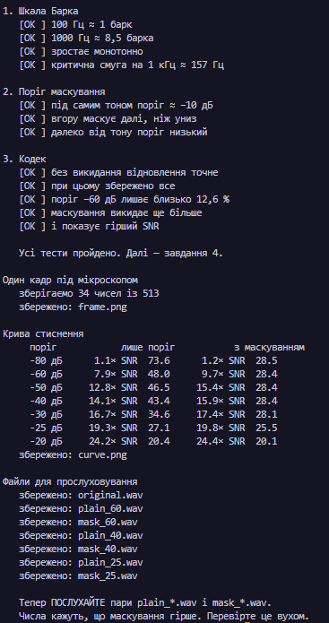

### Лабораторна робота № 14

### Робота: Токарчука Любомира

### Кодек-іграшка на маскуванні

### Результат в консолі:

### 

### Завдання 1:

Реалізовано функцію переведення частоти в герци у шкалу Барка. Перевірка показала, що 100 Гц відповідає 0,99 барка, а 1000 Гц — 8,5 барка. Шкала зростає монотонно, критична смуга на частоті 1 кГц становить приблизно 157 Гц. Усі тести пройдено успішно.

### Завдання 2:

Реалізовано функцію побудови кривої маскування, яка визначає поріг чутності для звукових складових. Перевірка показала, що під самим тоном поріг становить −10 дБ, маскування поширюється далі вгору за частотою, ніж униз, а на частоті 6000 Гц поріг опускається нижче −60 дБ. Усі тести пройдено успішно.

### Завдання 3:

Реалізовано кодування аудіосигналу за допомогою швидкого перетворення Фур'є та видалення складових, рівень яких нижчий за заданий поріг. Перевірка показала, що без видалення складових сигнал відновлюється з SNR понад 100 дБ. При порозі −60 дБ зберігається близько 12,6 % чисел. Усі тести пройдено успішно.

### Завдання 4:

Побудовано графіки залежності стиснення від якості звуку та створено сім WAV-файлів для прослуховування. Отримано результати для різних порогів відсікання. При використанні маскування кількість збережених чисел зменшується, але показник SNR також погіршується. Збережено графіки frame.png і curve.png та всі аудіофайли.

### Таблиця стиснення й SNR

| Поріг  |   Лише поріг    |  З маскуванням  |
| :----: | :-------------: | :-------------: |
| −60 дБ | 7,9× / 48,0 дБ  | 9,7× / 28,4 дБ  |
| −50 дБ | 12,8× / 46,5 дБ | 15,4× / 28,4 дБ |
| −40 дБ | 14,1× / 43,4 дБ | 15,9× / 28,4 дБ |
| −30 дБ | 16,7× / 34,6 дБ | 17,4× / 28,1 дБ |
| −25 дБ | 19,3× / 27,1 дБ | 19,8× / 25,5 дБ |

### Прослуховування аудіофайлів:

При порозі −60 дБ обидва файли звучать майже однаково, помітної різниці практично немає. При −40 дБ звук стає менш чітким, а відмінності між файлами помітніші. При −25 дБ якість обох записів помітно погіршується, звук стає менш чистим і з'являються спотворення.

### Відповіді на запитання:

#### 2. **Чому маскування рахують у барках, а не в герцах?**

Тому що шкала Барка враховує особливості людського слуху та зміну ширини критичних смуг залежно від частоти.

#### 3. **Поясніть пастку з вікном: чому симетричне дає 59 дБ, а періодичне — понад 100?**

Симетричне вікно не забезпечує точного складання кадрів із перекриттям 50 %, через що виникає похибка. Періодичне вікно забезпечує правильне складання кадрів і майже повне відновлення сигналу.

#### 4. **При порозі −60 дБ маскування дало SNR 28 замість 48. Ви почули різницю? Якщо ні — що це означає про SNR?**

Різниця між файлами була незначною на слух. Це означає, що SNR не завжди правильно відображає якість звуку, оскільки не враховує особливості людського слуху.
