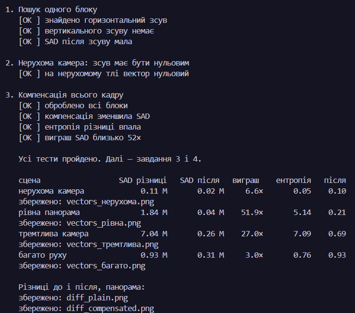

# Лабораторна робота №15

## Тема: Компенсація руху

**Дисципліна:** Розробка мультимедійних застосунків  
**Група:** КН-3/1  
**Роботу виконав:** Токарчук Любомир  
**Навчальний рік:** 2026/2027

## Мета роботи

Ознайомитися з принципами компенсації руху у відеопослідовностях, дослідити метод пошуку руху блоків кадру та навчитися оцінювати ефективність компенсації за допомогою SAD (суми абсолютних різниць) та ентропії.

## Хід роботи

### 1. Реалізація пошуку руху блоків

У ході виконання лабораторної роботи було реалізовано функцію `search_block()`, призначену для пошуку оптимального зміщення блоків між поточним і попереднім кадрами.
Для пошуку використовується метод повного перебору в межах заданого вікна пошуку з радіусом 16 пікселів. Початковим варіантом вважається нульове зміщення. Для кожного можливого положення блоку обчислюється SAD — сума абсолютних різниць між відповідними пікселями двох блоків. Найкращим вважається положення з найменшим значенням SAD.
Під час пошуку також перевіряються межі кадру, щоб уникнути виходу блоку за допустимі координати.

### 2. Реалізація компенсації руху

Було реалізовано функцію `compensate()`, яка послідовно обробляє кадр блоками розміром 16×16 пікселів. Для кожного блоку визначається вектор руху, після чого відповідна ділянка попереднього кадру копіюється до прогнозованого кадру.
Додатково обчислюється сумарна SAD до компенсації та після неї. Отримані вектори руху зберігаються для подальшої графічної візуалізації.

### 3. Тестування алгоритму

Після реалізації обох функцій було запущено автоматичні перевірки. Усі вісім тестів завершилися успішно. Було підтверджено правильність пошуку горизонтального зміщення, відсутність вертикального зміщення у відповідному тесті, нульовий вектор для нерухомого фону, обробку всіх блоків кадру та зменшення SAD після компенсації.
Таким чином, реалізовані алгоритми успішно пройшли передбачені програмою перевірки.

### 4. Дослідження різних типів руху

Для оцінювання ефективності компенсації було досліджено чотири тестові сцени: з нерухомою камерою та рухомим об'єктом, із рівномірною панорамою, із тремтінням камери та з великою кількістю незалежно рухомих об'єктів.
За результатами експериментів отримано такі показники:

| Тестова сцена    | SAD до компенсації | SAD після компенсації | Виграш |
| ---------------- | -----------------: | --------------------: | -----: |
| Нерухома камера  |           0,11 млн |              0,02 млн |   6,6× |
| Рівна панорама   |           1,84 млн |              0,04 млн |  51,9× |
| Тремтлива камера |           7,04 млн |              0,26 млн |  27,0× |
| Багато руху      |           0,93 млн |              0,31 млн |   3,0× |

Найкращий результат отримано для сцени з рівномірною панорамою, де компенсація зменшила SAD приблизно у 51,9 раза. Це пояснюється тим, що більшість блоків кадру мають однаковий напрямок зміщення.
Для сцени з тремтінням камери також отримано значне покращення — у 27 разів. У сцені з великою кількістю незалежно рухомих об'єктів ефективність виявилася нижчою, оскільки різні ділянки кадру рухаються в різних напрямках.

### 5. Аналіз ентропії та візуалізація

Додатково було досліджено ентропію різниці між кадрами до та після компенсації руху.

| Тестова сцена    | Ентропія до | Ентропія після |
| ---------------- | ----------: | -------------: |
| Нерухома камера  |        0,05 |           0,10 |
| Рівна панорама   |        5,14 |           0,21 |
| Тремтлива камера |        7,09 |           0,69 |
| Багато руху      |        0,76 |           0,93 |

Найбільше зменшення ентропії спостерігається для рівної панорами та тремтливої камери. Для нерухомої камери та сцени з великою кількістю рухомих об'єктів ентропія дещо зросла, що свідчить про те, що компенсація не завжди зменшує ентропію залишкової різниці.
Для наочного представлення результатів було створено зображення з векторами руху для кожної тестової сцени, а також зображення різниці між кадрами до та після компенсації.

**Створені графічні результати:**

- `vectors_нерухома.png` — вектори руху для сцени з нерухомою камерою.
- `vectors_рівна.png` — вектори руху для сцени з рівномірною панорамою.
- `vectors_тремтлива.png` — вектори руху для сцени з тремтінням камери.
- `vectors_багато.png` — вектори руху для сцени з багатьма рухомими об'єктами.
- `diff_plain.png` — різниця між кадрами без компенсації.
- `diff_compensated.png` — різниця між кадрами після компенсації.

### Результат в консолі:

### 

## Висновок

У ході виконання лабораторної роботи було реалізовано алгоритми пошуку та компенсації руху на основі блокового методу. Досліджено вплив різних типів руху на ефективність передбачення кадрів, а також проаналізовано зміну SAD та ентропії до і після компенсації.

Експериментальні результати показали, що компенсація руху особливо ефективна для сцен із рівномірним переміщенням камери, де вдалося зменшити SAD у 51,9 раза. Також було встановлено, що ефективність алгоритму залежить від характеру руху об'єктів у кадрі.

Усі автоматичні перевірки завершилися успішно. Поставленої мети роботи досягнуто, а отримані результати підтверджують працездатність реалізованих алгоритмів.
