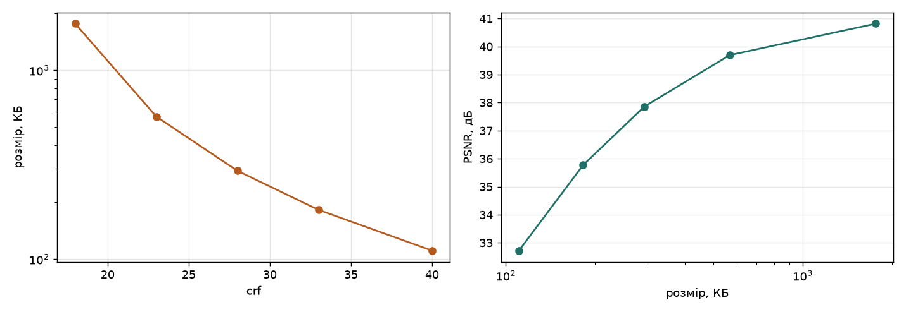
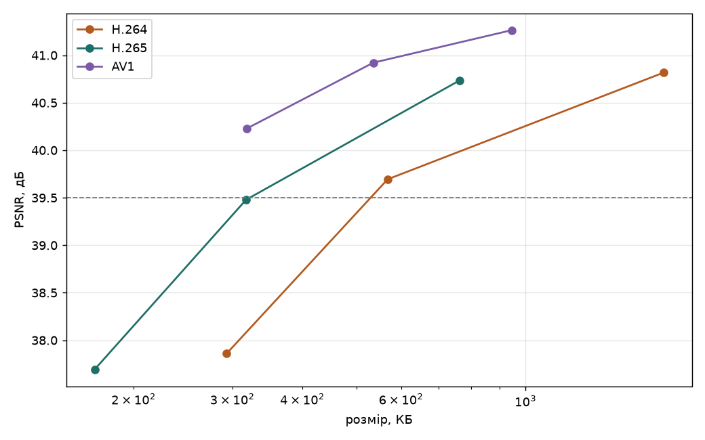
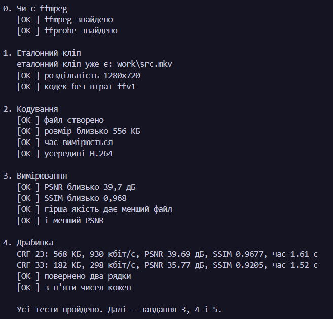

# Лабораторна робота №16

## Тема: Кодування відео ffmpeg та вимірювання якості

**Дисципліна:** Розробка мультимедійних застосунків  
**Група:** КН-3/1  
**Роботу виконав:** Токарчук Любомир  
**Навчальний рік:** 2026/2027

## Мета роботи

Навчитися кодувати відеокліп у H.264 за допомогою ffmpeg, використовувати параметр CRF та preset, вимірювати якість стиснення метриками PSNR і SSIM і будувати графік залежності розміру файлу від якості.

## Хід роботи

### 1. Створення еталонного кліпу

Було створено еталонний відеокліп `work/src.mkv` роздільністю 1280×720 пікселів тривалістю 5 секунд. Джерело зібране кодеком ffv1 у форматі без втрат і містить 150 кадрів із частотою 30 кадрів за секунду. Розмір еталонного кліпу становить 82 МБ.

Властивості еталонного файлу, отримані функцією `probe()` і утилітою `ffprobe`:

| Властивість        | Значення        |
| ------------------ | --------------- |
| Контейнер          | Matroska/WebM   |
| Кодек відеодоріжки | ffv1            |
| Профіль            | unknown         |
| Роздільність       | 1280×720        |
| Частота кадрів     | 30 кадрів/с     |
| Формат пікселів    | yuv420p         |
| Тривалість         | 5 с             |
| Розмір файла       | 86 001 404 байт |

Бітрейт еталонного кліпу дуже великий, оскільки ffv1 є кодеком без втрат і зберігає практично всі піксельні дані колажу. Тому ffv1 придатний як еталон для порівняння з втратними кодеками.

### 2. Реалізація кодування

У функції `encode()` реалізовано запуск ffmpeg із параметрами H.264, CRF, preset, формату пікселів `yuv420p` і діапазону кольору `tv`. Функція вимірює час кодування, повертає розмір вихідного файлу в байтах і повідомляє про помилки ffmpeg.

Параметр CRF та параметр бітрейту не передаються одночасно, оскільки це призводить до неочевидної фінальної налаштуваності кодування.

### 3. Реалізація вимірювання якості

У функції `measure()` для порівняння закодованого відео з еталоном застосовано фільтр ffmpeg з вирівнюванням міток часу. Для кожного кадру встановлено однакову позицію через `setpts=N/{fps}/TB`, формат зведено до `yuv420p`, а діапазон кольору — до `tv`.

Після запуску окремо обчислено метрики PSNR і SSIM. Значення взято з підсумкового виводу ffmpeg:

- для PSNR — число після `average`;
- для SSIM — число після `All`.

### 4. Побудова драбинки CRF

Проведено кодування еталонного кліпу для значень CRF 18, 23, 28, 33 і 40. Для кожного файлу виміряно розмір, середній бітрейт, PSNR, SSIM і час кодування.

| CRF |  Розмір |     Бітрейт |     PSNR |   SSIM |   Час |
| --: | ------: | ----------: | -------: | -----: | ----: |
|  18 | 1762 КБ | 2886 кбіт/с | 40,82 дБ | 0,9770 | 2,0 с |
|  23 |  568 КБ |  930 кбіт/с | 39,69 дБ | 0,9677 | 1,6 с |
|  28 |  293 КБ |  480 кбіт/с | 37,86 дБ | 0,9480 | 1,5 с |
|  33 |  182 КБ |  298 кбіт/с | 35,77 дБ | 0,9205 | 1,4 с |
|  40 |  111 КБ |  181 кбіт/с | 32,72 дБ | 0,8747 | 1,6 с |

Отримані залежності підтверджують очікувану закономірність: зі збільшенням CRF розмір файлу та якість відео зменшується. Найкраща якість отримана при CRF 18, але цей файл є найбільшим. При CRF 23 розмір становить 568 КБ, PSNR дорівнює 39,69 дБ, а SSIM — 0,9677.

Для відео, що викладається в інтернет, найбільш доречним є **CRF 23**. У діапазоні від 18 до 23 розмір зменшується з 1762 до 568 КБ, а PSNR втрачає лише 1,13 дБ. Подальше зниження якості коштує менше розміру: від 23 до 28 файл зменшується до 293 КБ, але PSNR опускається на 1,83 дБ. Отже, CRF 23 є практичною основою для збереження прийнятної якості без надмірного розміру файлу.

### 5. Визначення впливу вирівнювання міток часу

Тестове порівняння без вирівнювання міток часу дало майже однакові значення PSNR для всіх рівнів якості:

| CRF | PSNR з вирівнюванням | PSNR без вирівнювання |
| --: | -------------------: | --------------------: |
|  18 |             40,82 дБ |              27,00 дБ |
|  23 |             39,69 дБ |              26,98 дБ |
|  28 |             37,86 дБ |              26,95 дБ |
|  33 |             35,77 дБ |              26,89 дБ |
|  40 |             32,72 дБ |              26,71 дБ |

Неправильний варіант порівняння не показує різниці між високою та низькою якістю кодування. Це пов'язано з тим, що без `setpts` кадри порівнюються з несумісними позиціями, тому декодовані фрагменти поступово зміщуються відносно еталонної панорами.

При виконанні команди:

```powershell
ffmpeg -i work/q18.mp4 -i work/src.mkv -lavfi psnr -f null -
```

ffmpeg видав попередження:

```text
not matching timebases found between first input: 1/15360 and second input 1/1000,
results may be incorrect!
```

Для неправильного вимірювання PSNR становить 27,00 дБ при CRF 18 і 26,71 дБ при CRF 40. Різниця лише **0,29 дБ**, хоча правильне вимірювання дає різницю **8,10 дБ** (40,82 проти 32,72 дБ). Ознакою зіпсованого вимірювання є практично однакова метрика для різних CRF і попередження про несумісні часові основи або діапазони кольору.

### 6. Побудова графіка

За результатами драбинки побудовано графік `rd.png` із двома панелями:

- залежність розміру файлу від CRF;
- залежність PSNR від розміру файлу.

### 

### 7. Порівняння кодеків

Проведено порівняння H.264, H.265 і AV1 за близькими рівнями виміряної якості.

| Кодек | CRF |  Розмір |     PSNR |
| ----- | --: | ------: | -------: |
| H.264 |  18 | 1762 КБ | 40,82 дБ |
| H.264 |  23 |  568 КБ | 39,69 дБ |
| H.264 |  28 |  293 КБ | 37,86 дБ |
| H.265 |  20 |  762 КБ | 40,73 дБ |
| H.265 |  25 |  317 КБ | 39,48 дБ |
| H.265 |  30 |  170 КБ | 37,69 дБ |
| AV1   |  25 |  945 КБ | 41,26 дБ |
| AV1   |  35 |  535 КБ | 40,92 дБ |
| AV1   |  45 |  318 КБ | 40,23 дБ |

### 

На горизонтальній лінії PSNR 39,5 дБ наближено отримано такі розміри:

| Кодек | Розмір при 39,5 дБ | Виграш проти H.264 |
| ----- | -----------------: | -----------------: |
| H.264 |   приблизно 539 КБ |                  — |
| H.265 |   приблизно 320 КБ |     приблизно 41 % |
| AV1   |   приблизно 234 КБ |     приблизно 57 % |

Отже, для цього кліпу нові кодеки дають менший розмір при порівняній виміряній якості. Виграш H.265 відносно H.264 становить близько 41 %, а AV1 — близько 57 %.

Цей висновок справедливий лише для даного рівномірного кліпу з панорамою та спокійним колажем. На хаотичному відео виграш сучасних кодеків може бути меншим, тому з одного кліпу неможливо робити загальний висновок про перевагу всієї реалізації кодека.

## Відповіді на запитання

1. **Контейнер відрізняється від кодека тим, що контейнер зберігає організацію однієї або кількох доріжок, а кодек описує спосіб кодування даних доріжки.** Наприклад, контейнер MP4 може містити відео H.264 або H.265. Тому проблеми відтворення бувають пов'язані саме з відсутністю підтримки кодека, а не з самим контейнером.
2. **`-crf` задає сталий рівень цільової якості:** менше значення означає кращу якість і більший розмір. Його використовують для зберігання або публікації відео. `-b:v` задає сталий бітрейт і його використовують у потоковій трансляції, де потрібна відома пропускна здатність каналу.
3. Порівнювати H.264 і H.265 за однаковим CRF неможливо коректно, бо шкали CRF належать різним кодекам і їхні реалізації дають різну якість при однаковому числі.
4. PSNR показує середню квадратну похибку відносно еталона в децибелах, а SSIM — структурну схожість. Вони не гарантовано показують суб'єктивну схожість і можуть не відображати сприйняття текстур або спотворень людським зором.
5. Перед порівнянням потрібно вирівняти мітки часу, діапазон яскравості та формат пікселів.
6. Вимірювання зіпсоване, якщо метрика майже не змінюється при сильній зміні CRF. Також ознакою є попередження ffmpeg про несумісні timebase або різні колірні діапазони.
7. Для публікації відео в інтернет рекомендовано CRF 23, оскільки він зберігає високу якість при значно меншому розмірі порівняно з CRF 18. Подальше зниження до CRF 28 дає більшу економію розміру, але якість падає відчутніше.

## Висновок

У ході лабораторної роботи створено еталонний відеокліп, реалізовано кодування ffmpeg у форматі H.264, вимірювання PSNR і SSIM та побудовано драбинку якостей CRF.

Усі автоматичні перевірки виконано успішно. Експеримент показав, що зростання CRF зменшує розмір і бітрейт файлу, але погіршує PSNR і SSIM. Вирівнювання міток часу є обов'язковою частиною коректного порівняння відеопослідовностей, оскільки без нього метрики майже перестають відображати рівень спотворень.

### результат в консолі:

### 

### 
